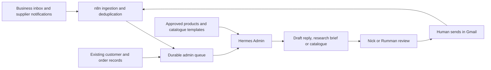

# NovaMerch admin agent plan

**Document status:** current admin design, not deployed. This supersedes the initial Hermes outline and tentative experiment budget in the [acquisition strategy](acquisition-research-and-hermes-plan.md). See [implementation status and next work](README.md). Updating this plan does not activate schedules or authorise a purchase.

**Deployment note (2026-09-12):** a first version of the infrastructure this plan describes is now actually running — see [hermes-deployment-and-access.md](hermes-deployment-and-access.md) for what's live, why, and how to access it (server, model provider, Composio integrations, Telegram bot). That doc tracks deployed reality; this one stays the design reference.

## Recommendation

Build one Hermes agent named **NovaMerch Admin**, connected to the existing n8n workflows, business inbox and order records. Give it five procedures: inbox triage, supplier research, order monitoring, catalogue preparation and a weekly process review. Keep customer replies as drafts for Nick or Rumman to review. Introduce automatic customer order updates only after a successful pilot and a separately approved sending rule.

The lowest-cost starting point is a supervised local Hermes pilot using existing catalogue files and a small paid API allowance. For dependable daily operation, move the same configuration to an isolated, always-on host. A small self-managed VPS is the preferred cost baseline if someone owns maintenance; managed Hostinger is a reasonable convenience alternative if its checkout terms and integration tests pass. Do not buy another computer, a vector database, a catalogue subscription or several specialist agents initially.

Keep n8n responsible for schedules, collecting events, retries and recording outcomes. Hermes should interpret and prepare work only when new information needs attention. A deterministic template is sufficient for many shipment milestones; it should not require an AI conversation for every tracking scan. This division is a proposed architecture, not an integration already installed.

This plan uses public vendor information checked on 11 September 2026 and inspected NovaMerch project files. Prices can change. No host, model, browser integration or supplier-account access has been purchased or provisioned for this plan.

## What the videos contribute

Nate Herk’s May 10 course describes a VPS installation, Telegram, skills, scheduled work and GitHub backups. His August 27 shorter video describes Hostinger’s managed service, dashboard, context, API keys and ChatGPT connection. Both descriptions include Hostinger discount links. They are useful setup guides, but do not establish which configuration is cheapest for NovaMerch or whether it safely handles this inbox and catalogue workload.[1][2]

The video descriptions and chapter outlines were available; a complete transcript was not available during review. Detailed claims about their demonstrations are therefore excluded. Current vendor documentation takes precedence over older setup instructions. In particular, “connect your subscription” must not be interpreted as unlimited inference or included browser, image-generation and hosting costs.

Hermes supports multiple model providers, persistent memory, skills and external tools. Those capabilities fit the proposed assistant, but neither memory nor learned procedures should become the authoritative record of an order.[3]

## Existing foundations worth keeping

The catalogue directory is actually `novamerch/local-catalogues/` inside Desktop’s Coding Projects folder. It contains sports and business HTML/CSS templates, customer folders, images, proposals, order forms and invoices. Examples include Swell Fitness, Cooks Hill, Blue Horizon, DAL Constructions and Warnervale. This is a valuable reusable production system, not a folder to replace with generic AI designs.

The README describes a Node proposal generator that reads a lead, selects a template, substitutes branding and creates a Draft proposal record. The generator exists. Its normal eligibility gate accepts Replied, Mockup Requested or Interested; it also exposes a `--force` override. The automated agent should receive an exact-ID wrapper that cannot invoke that override. The existing script has side effects, so it should not be used as a harmless preview command.

The roadmap lists duplicate detection, Airtable timeouts, margin validation and ambiguous name matching as unfinished. Inspection confirms use of a parsed numeric margin and a force flag; hardening needs a focused implementation review before unattended use. There is also a documented export contradiction: the README and actual CSS specify A4 portrait, while the roadmap’s planned PDF exporter says landscape. Use the real portrait templates as the default.

The old roadmap’s approximately $0.32 proposal target covers a historical image-generation assumption, not total production cost. It is not a current budget. Its admin-panel issue list is a backlog to recheck, not proof every issue remains present today.

The earlier account audit found missed inbound interest, Airtable capacity problems, a broken discovery workflow and a handoff gap before initial sending. Admin automation should first protect buying conversations from being missed. The existing orders base must remain distinct from the overloaded lead base. Read its actual schema and capacity before choosing where new job records live.

## Hosting and model economics

The table compares advertised infrastructure prices, not equivalent complete services. Dollar amounts below are the vendors’ dollar prices, treated as USD for planning; confirm checkout currency, taxes, term, renewal, region and add-ons before purchase. No AUD conversion is assumed.

| Option | Price evidence | NovaMerch assessment |
|---|---|---|
| Existing Mac | No new hosting subscription; electricity, existing hardware and model/tool usage remain | Best supervised pilot. Cannot provide reliable checks while asleep, offline or shut down. |
| Existing Railway, separate service | Hobby minimum $5/month with $5 usage included; resources beyond allowance cost extra | Check existing plan and marginal usage first. Existing n8n spend may already consume credits. Do not place Hermes inside the n8n container. |
| Hetzner CX23, EU | Published new price €5.49/month or $6.49/month, excluding IPv4, after June 15 adjustment | Low recurring self-managed baseline; confirm availability and specifications at checkout. Patch, backup and recovery work belong to NovaMerch. |
| Hostinger Managed Hermes | Advertises $5.99/month, renewal $11.99/month for two years; plans paid upfront | Competitive convenience option. Initial term, payable total, browser/PDF dependencies, storage export and resource limits need confirmation. No inference allowance should be assumed unlimited. |
| Nous Hermes Cloud Medium | $0.56/day running; $0.03/day stopped | About $16.80 for 30 continuously running days, before model/tool charges. Straightforward first-party option, but not the lowest published continuous-hosting price. |

Sources: Railway pricing, Hetzner price adjustment, Hostinger managed offering and Nous Cloud.[4][5][6][7] Nous’s page mixes “scales to zero” marketing with uptime-based billing. Budget the published running rate unless the account demonstrates actual idle savings. A $2 credit minimum to deploy is not a $2 monthly hosting price.

**Decision rule:** test locally first; then prefer a separate Railway service only if a measured estimate is competitive. Otherwise use the small VPS when maintenance has a named owner. If nobody will maintain it, choose managed hosting after the required integrations work. Saving a few dollars is not worthwhile if an outage hides customer enquiries. Do not commit to a long prepaid term before that test.

For models, benchmark a cheap paid API on real, sanitised examples rather than assuming the most expensive model is necessary. Google lists Gemini 2.5 Flash-Lite at $0.10 input/$0.40 output per million tokens, and Gemini 2.5 Flash at $0.30/$2.50. These are useful cost baselines, not a claim that these models are the best current Hermes orchestrators. Hermes documents a Gemini API provider. Confirm model availability and tool-call quality at installation.[8][9]

Start with the inexpensive model for classification and structured extraction; use a more capable model only for difficult research or drafts that fail validation. If a small model needs repeated retries, it may cost more in staff review than it saves in tokens. Free Gemini usage has different data treatment from paid usage; the pricing page marks free content as used to improve products and paid content as not used for that purpose. Use sanitised data for free trials, and review provider handling before connecting business mail.[8]

An illustrative month of 10 million input tokens and 1 million output tokens costs $1.40 at the listed Flash-Lite rates or $5.50 at the Flash rates. These are arithmetic scenarios, not a workload forecast. Browser sessions, images, searches, storage, retries, reasoning and repeated context may add cost. For a controlled VPS pilot, reserve roughly **US$15–30/month incremental operating spend**, excluding tax, existing subscriptions, staff time, samples and orders. This is a proposed budget, not a vendor bundle or guarantee.

Nous Portal’s $20 Plus plan provides $22 monthly credits and a $10 rollover cap; hosted tools consume a separately metered resource budget rather than becoming unlimited. It is an optional simplicity purchase once measured usage justifies it.[7][10] Do not add it alongside several other subscriptions by default. The videos’ ChatGPT path can be evaluated as an optional local trial, but this plan does not rely on unverified subscription quota economics.[1][2][9]

Cost controls belong in the job runner: skip unchanged records; one active job per thread/order; bounded input and output; two retries; maximum research time and page count; daily spend checks; no automatic paid-provider fallback. Stop optional research when the budget is reached and retain incoming work in the queue. Provider billing alerts alone are not assumed to be hard caps.

## Architecture and access

Use authenticated webhooks from n8n to trigger bounded Hermes work, with the response initially logged or written to a draft queue. Hermes documents HMAC-validated webhooks and route-specific tools.[11] Expose a short allowlist of tools: read thread, read order, retrieve approved product, create draft, propose order change, build catalogue and report job result. MCP supports tool inclusion filters, but the backing service must enforce the permissions too.[12]

Do not give the admin agent unrestricted n8n publishing, cloud billing, account administration, payment, purchase or terminal access. A sandboxed catalogue renderer may run an approved command against an approved working directory. It should not share mailbox tokens or supplier-login cookies with a general terminal. Research pages, emails and attachments are untrusted content, even when received through an authenticated connector.

Use existing database capacity if it can provide durable job records without a new upgrade. Otherwise a small SQLite queue on the single agent host is sufficient for the pilot; a review Sheet can mirror it for staff. The database, not a spreadsheet checkbox, controls job claims and duplicate prevention. Do not add more prospect records to the already full lead base to store agent logs.

A job needs: job ID, type, customer/order/thread IDs, source message ID, source timestamp, deduplication key, status, owner, attempt count, draft ID, evidence references, cost and last error. Suggested states are Pending, Working, Needs Review, Approved, Completed, Failed and Superseded. Drafted does not mean sent; supplier-dispatched does not mean delivered to the customer.

## Daily workflow 1: inbox triage and drafts

Check new business mail every 15 minutes during working hours, plus a morning catch-up. Use a stored cursor with an overlap window and deduplicate by message ID. Include sent messages to detect when Nick has already answered. Review spam daily without moving suspicious messages automatically. Keep supplier notifications, bounces and customer messages in scope.

Classify into new enquiry, existing quote, artwork approval, order question, supplier message, tracking event, invoice/payment, complaint, unsubscribe/bounce and irrelevant mail. Link to the full thread and the correct customer record. Existing buying conversations and delivery exceptions receive priority over new prospect research.

For each actionable thread, prepare a short draft using the latest conversation, current order state and confirmed business policies. The review item should show the proposed recipient, sender identity, subject, body, attachments, supporting facts and unresolved questions. Keep internal notes out of the email body. Never overwrite a human-edited draft; create a new proposed revision or mark the existing proposal stale.

Use Gmail’s actual draft object so Nick or Rumman can open, edit and send it normally. Gmail’s `gmail.compose` scope also permits sending: there is no assumption that an OAuth “draft” scope alone prevents sends. Keep the OAuth token in a narrow broker that only exposes validated draft operations to Hermes; do not expose send endpoints or its raw token.[13] Until that broker exists, save proposed replies in the private review queue.

Hermes’s email gateway is not the right inbox ingestion mechanism. It is intended for conversing with the agent and ignores several automated senders and headers. Supplier notifications and bounce processing need a dedicated mailbox workflow.[14] A private owner-control channel may be added later; it should not auto-reply to customers.

Before creating or approving a reply, re-read the latest thread. If new mail arrived, the draft is stale. After a human sends, reconcile the sent message and update the queue. Unsubscribe and bounce handling must also update the acquisition suppression process so a parallel follow-up cannot continue contacting the same address.

## Daily workflow 2: Alibaba and AliExpress research

Start from a concrete brief: product, quantity, required date, delivery postcode, material, colours, size range, logo file and decoration method. An unclear requirement produces a clarification draft, not a guessed purchase recommendation.

Search the approved product library first. Then use Alibaba for a customised or repeat bulk requirement and AliExpress as a candidate for samples or small ready-made quantities, subject to the actual listing. This is a sourcing strategy, not a guarantee about either marketplace. Add an Australian supplier alternative when delivery urgency could outweigh a lower overseas unit price.

Return a maximum of three serious options per brief. Each option needs its listing URL, seller identity, observed date, exact variant, material, dimensions, MOQ, price tiers and currency, decoration/setup cost, sample cost, production time, freight, shipping basis, estimated delivered cost and unresolved questions. Missing values must stay Unknown. A cheap default variant must not be substituted for the requested product.

Separate listing claims from supplier-confirmed facts and received-sample observations. Preserve quotation IDs, specifications and relevant correspondence. Alibaba’s Trade Assurance is tied to eligible orders and agreed terms; it is not a blanket quality endorsement. Record applicable protection and inspection requirements without treating a badge as proof the product meets the brief.[15]

Landed cost should include goods, branding, setup, samples where allocated, freight, insurance, applicable import charges, local delivery and a documented contingency. Use a dated currency rate and clearly labelled assumptions. The existing margin formula is cost divided by one minus target margin; apply it only after Nick confirms the business’s treatment of tax, discounts and target margin. Do not invent a firm quote from incomplete freight data.

Use public browsing first. If a listing, order or message requires login, use a dedicated business session in an isolated browser and human completion of authentication. Marketplace automation access, API eligibility and live account behaviour have not been verified. Do not promise a free universal Alibaba/AliExpress API. On CAPTCHA or access restrictions, stop that lookup and surface a manual action rather than buying proxies or attempting bypasses.

Hermes may draft supplier questions. Nick or Rumman approves sending enquiries, samples, purchase orders, artwork and payments. Initial success is a trustworthy comparison that saves research time, not an autonomous buying agent.

## Daily workflow 3: order updates

Maintain an explicit mapping between NovaMerch order ID, customer, supplier order ID, items and quantities, destination, shipment leg, carrier, tracking IDs and promised dates. One supplier order may cover several customer orders; one customer order may have several parcels. Ambiguous matching requires review.

Use incoming supplier mail as a low-cost signal. Extract the claimed event and preserve the original internally. Confirm significant shipping claims against the order or carrier where possible. Model shipment legs separately: supplier to NovaMerch, inspection/branding/repacking at NovaMerch, then NovaMerch to customer. A delivery to NovaMerch must never generate “your order has been delivered” to the customer.

Use milestone states such as production confirmed, production complete, label created, carrier accepted, international transit, customs, received by NovaMerch, final dispatch and customer delivery. Record partial shipments separately. Do not advance state merely because a supplier created a label or a marketing email says an order is “on its way.” Retain the evidence time and confidence.

Customer updates should be written entirely as NovaMerch communications. Omit Alibaba, AliExpress, seller/store links, supplier invoice attachments, internal purchase prices and margins. Keep all of those in the internal evidence record. Avoid forwarding or lightly editing the raw notification, because quoted headers, images and links can leak supplier information.

This must remain truthful. Do not claim Australian manufacture, local stock, ownership of a factory, completion of inspection or a guaranteed delivery date without evidence. If asked directly about sourcing, escalate for an accurate answer; do not fabricate a local origin. Marketplace names are unnecessary in routine status messages, but material delays and relevant facts must still be disclosed.

Example draft, only when confirmed:

> Hi [name], a quick update on order [NovaMerch ID]: production is complete and the carrier has collected the shipment. The current estimated arrival window is [dates]. We’ll confirm the next step once it arrives with us and has been checked. Cheers, Nick — NovaMerch.

For a delay, state the actual known delay and the next check time. Do not fill an unknown ETA with a reassuring guess. Tracking links should be official carrier links when suitable; marketplace URLs stay internal. If even a carrier link exposes unwanted supplier details, use a text status update and offer tracking assistance.

Phase one produces drafts only. A later automatic path can use a fixed, approved template for a verified milestone, matched customer, known shipment leg and no active complaint. Require a unique order/milestone/shipment key, and reconcile uncertain send results before retrying. All exceptions, delays, money disputes and changed promises remain reviewed. An approval must bind to the exact recipient, content version and attachments and expire if those change.

## Daily workflow 4: customer catalogues

Reuse the existing HTML/CSS and approved imagery. Prefer a concise two-to-four-product proposal responding to the enquiry over a large generic catalogue. Match business/sports layout, brand colour and actual supplied logo; confirm a website’s social image really is the logo before using it.

Give Hermes structured product records rather than asking it to rewrite the entire layout each time. Keep product IDs, titles, description, decoration, colour/size choices, confirmed prices, quantity tiers and quote-validity date in a data file. The renderer fills a versioned template. Historical catalogue prices and quantities must not be carried into a new proposal as current supplier facts.

Use approved product photography and deterministic logo placement where feasible. Label digital branding previews as mockups; they do not prove a real sample exists. Paid image generation should be optional for a specific missing view, with a per-proposal cap and approval of the final image. Do not introduce Canva or another design subscription just to recreate the current PDF layout.

The proposed exporter uses headless Chromium to print A4 portrait with backgrounds and no margins. It must wait for fonts and images, report missing assets, and generate preview images for visual review. The current roadmap describes PDF automation as planned, so implementing and testing it remains work.

Before review, check for unresolved placeholders, broken images, wrong customer name/logo, another customer’s details, clipped text, blank pages, obsolete contact information, unsupported claims and unconfirmed prices. Also inspect links and metadata for supplier URLs or internal costs. Deliver editable HTML/assets plus the PDF into a new versioned folder; never overwrite a sent catalogue.

The directory is gitignored. A normal repository backup will not protect it or automatically make it available to a cloud Hermes agent. Create an explicit private asset sync and encrypted backup with version history. Sync only the approved catalogue workspace; keep `.env` files, authentication data and unrelated Desktop documents excluded. Cloud outputs can sync back to the same local workflow.

## Daily workflow 5: operational improvement

Provide one morning brief with unanswered enquiries, drafts awaiting review, overdue quotes, shipping exceptions, supplier questions, stale information and workflow failures. Every item has an owner, due time and a link to its evidence. A quiet system produces a short “no action needed” result in the dashboard, not repeated messages.

Once a week, identify the top three avoidable delays using recorded data: repeated manual steps, missing fields, frequent corrections, failed jobs, excess tool spend and slow quote turnaround. Propose one small improvement with expected staff time saved, implementation cost and a success measure. Hermes may prepare a patch or procedure revision in a sandbox; it should not deploy production changes or rewrite its permissions.

Maintain approved procedures as versioned skills. Corrections from Nick or Rumman should become proposed rule changes for review. Keep business identity, tone, product policy and permission rules in compact context; fetch live customer/order facts when needed. Do not let a mistaken remembered fact silently override the database.

## Implementation sequence

| Stage | Concrete work | Completion evidence |
|---|---|---|
| 1. Business setup | Confirm monitored mailbox/aliases, signature/phone, owners, hours, order schema, catalogue assets and budget | A signed-off configuration sheet; no unanswered identity or data-location ambiguity |
| 2. Local replay | Install isolated Hermes; ingest sanitised historical examples; build draft broker and durable queue | Correct customer/thread matching and zero unapproved outbound operations |
| 3. Live drafting | Enable incremental inbox checks; create reviewed Gmail drafts; reconcile human replies | Five business days without lost or duplicate jobs; reviewer corrections recorded |
| 4. Sourcing/catalogues | Harden generator, create product brief schema, implement PDF export and private asset sync | Three relevant comparisons and three clean reviewed catalogue PDFs |
| 5. Order monitoring | Map active orders and shipment legs; replay notifications; draft milestone updates | All test milestones correct, including partial and inbound-to-NovaMerch deliveries |
| 6. Production host | Select measured hosting option, backup/restore, restart supervisor and failure alerts | Recovery test and cost log; queue survives restarts |
| 7. Limited automation | Separately approve fixed routine updates after replay and pilot results | No duplicates, no supplier leakage and traceable approval/sending records |

An initial planning allowance is roughly 18–30 engineering hours across one to two weeks, plus Nick/Rumman review time. This is an estimate, not a quote: account access, generator issues and supplier login behaviour can extend it. Start with inbox drafts to produce value before completing the more variable marketplace work.

## Acceptance tests and operating rules

Use at least 30 representative historical/synthetic cases: new enquiry, existing quote, customer correction, unsubscribe, bounce, spam-hidden reply, supplier update, duplicate notification, partial shipment, wrong order ID, delivery to NovaMerch, delay, complaint, missing price, expired quote, malicious page instruction and an email arriving during draft review.

Required outcomes: no unapproved sends or purchases; no wrong customer associations; no missed opt-outs in the test set; no supplier names, costs or links in customer artifacts; no invented prices/dates; no duplicate jobs after replay/restart; and visible exceptions instead of silent failures. Run attachment and PDF checks on every catalogue. Pilot targets are 80% of drafts needing only minor edits and a measurable reduction in time spent on triage/research; these are acceptance targets, not predicted performance.

Back up the queue, configurations and approved assets daily. Keep tokens out of logs and Git; encrypt operational backups. Test restore rather than assuming a file copy is sufficient. Pause the agent if credentials fail, spend exceeds the cap, customer mapping is uncertain or a validation rule fails. Incoming events remain queued for manual handling. Hermes security features help with isolation and approvals, but business permissions require enforcement in the actual tools.[16]

## Decisions before implementation

Confirm the correct phone/signature: current initial and follow-up templates contain different numbers. Confirm which mailbox and aliases receive all supplier notifications; whether Nick and Rumman can both review drafts; who owns each customer; and whether supplier orders go to NovaMerch first or directly to customers. Establish a normal reply target and escalation owner.

Choose an incremental monthly budget and a hosting maintenance owner. Verify Google account eligibility before relying on Gemini or Gmail credentials: the earlier audit found a suspension notice for a different workflow-related project, and this plan must not assume that issue has been resolved. Confirm current account status rather than creating replacement projects to evade restrictions.

Start with read/draft mode, the existing templates, and one product brief tied to a real enquiry. Preserve human sending during the pilot. The system is ready to expand when its outputs are accurate, recoverable and cheaper in total staff effort—not simply when Hermes can answer a chat message.

## Sources

1. Nate Herk, [Hermes Agent: Zero to Personal AI Assistant](https://www.youtube.com/watch?v=gb5TlGw6Uks), May 10, 2026. Description and chapters reviewed in Chrome.
2. Nate Herk, [Set Up a Personal Hermes in 14 Mins](https://www.youtube.com/watch?v=gQef3d3erOs), August 27, 2026. Description and chapters reviewed in Chrome; full transcript unavailable.
3. Nous Research, [Hermes documentation](https://hermes-agent.nousresearch.com/docs/), accessed September 11, 2026.
4. Railway, [Pricing](https://railway.com/pricing), accessed September 11, 2026.
5. Hetzner, [Price adjustment, June 15, 2026](https://docs.hetzner.com/general/infrastructure-and-availability/price-adjustment/), accessed September 11, 2026.
6. Hostinger, [Managed Hermes pricing](https://www.hostinger.com/managed-hermes-agent) and [setup overview](https://www.hostinger.com/support/hostinger-managed-hermes-overview-and-setup/), accessed September 11, 2026.
7. Nous Research, [Hermes Cloud and Portal plans](https://portal.nousresearch.com/cloud), accessed September 11, 2026.
8. Google, [Gemini Developer API pricing](https://ai.google.dev/gemini-api/docs/pricing), accessed September 11, 2026.
9. Nous Research, [Model providers](https://hermes-agent.nousresearch.com/docs/integrations/providers), accessed September 11, 2026. Third-party integration documentation does not independently settle provider subscription terms.
10. Nous Research, [Nous Portal integration](https://hermes-agent.nousresearch.com/docs/integrations/nous-portal), accessed September 11, 2026.
11. Nous Research, [Webhooks](https://hermes-agent.nousresearch.com/docs/user-guide/messaging/webhooks/), accessed September 11, 2026.
12. Nous Research, [MCP integration](https://hermes-agent.nousresearch.com/docs/user-guide/features/mcp), accessed September 11, 2026.
13. Google, [Gmail API scopes](https://developers.google.com/workspace/gmail/api/auth/scopes), accessed September 11, 2026.
14. Nous Research, [Email gateway](https://hermes-agent.nousresearch.com/docs/user-guide/messaging/email), accessed September 11, 2026.
15. Alibaba, [Trade Assurance](https://tradeassurance.alibaba.com/), accessed September 11, 2026. Protection remains subject to applicable order terms.
16. Nous Research, [Security](https://hermes-agent.nousresearch.com/docs/user-guide/security), accessed September 11, 2026.
17. NovaMerch private project files: `local-catalogues/README.md`, `PROPOSAL-AUTOMATION-ROADMAP.md`, `scripts/generate-proposal.js`, both base CSS templates, and the Swell confirmed-order HTML; inspected September 11, 2026. Internal context also draws on `docs/acquisition-audit-2026-09-11.md` and `docs/acquisition-research-and-hermes-plan.md`. No credentials reproduced.
